A research paper can contain a difficult calculation without presenting it as a problem. The useful structure may be buried in a proof, mixed with general hypotheses, or visible only after several estimates are combined. Turning that structure into a concise question requires mathematical work: identify the target, settle its conventions, and obtain a reference solution that supports the answer being requested.

[Paper Math Bench](https://github.com/BrookWW/SkillofCreatingCalculationProblems/tree/a0d612260f2fabfe09f102b9bb1b59b74931450d) is my reusable Codex skill for this task. It connects literature research, problem construction, independent statement review, and model evaluation. This post follows the repository's [README](https://github.com/BrookWW/SkillofCreatingCalculationProblems/blob/a0d612260f2fabfe09f102b9bb1b59b74931450d/README.md), including its worked example: an extremal weighted partition sum whose answer depends on an entropy maximum, Gaussian fluctuations, and a contribution from small blocks.

The two [earlier](../harmonic-maps-in-lean/) [posts](../stationary-harmonic-maps-in-lean/) concerned formal proofs of regularity theorems. Here the object being built is a calculation problem and the evidence needed to evaluate a particular version of it. The reference solution and mathematical review carry the correctness judgment; a model trial supplies evidence about that model's attempt.

The project, at a glance

- **Research:** find substantive calculations in mathematical literature.
- **Authoring:** write a concise English question and a complete reference solution.
- **Review:** check that the statement specifies the intended task, and that editorial changes preserve its mathematics.
- **Evaluation:** run a fresh solver on the reviewed version and retain the submission, grading, and usage record.

The public package contains the reusable skill, supporting scripts and guides, blank templates, synthetic implementation tests, and one worked example.

## What makes a useful calculation problem? {#problem-design}

The design principle is mathematical depth. A short statement may require a substantial chain of reasoning, but length, unfamiliar notation, or missing conventions do not create useful difficulty.

The [README](https://github.com/BrookWW/SkillofCreatingCalculationProblems/blob/a0d612260f2fabfe09f102b9bb1b59b74931450d/README.md#what-the-skill-does) asks for clear problem-specific definitions and conventions that affect the answer. Standard concepts can be named directly. Formulas should carry the statement where they express the task more accurately and economically than prose.

These requirements matter when extracting a problem from a paper. An asymptotic calculation might ask for an exponential rate, a power of $n$, an exact leading coefficient, or all three. Those are different tasks. The final question must say which one is required, and the reference must establish the same conclusion with the same normalization.

This also explains why source reading and reference construction precede formal testing. A solver's failure cannot establish that an ambiguous question has a well-defined answer. Conversely, a correct response can reveal that a proposed calculation is easier than expected without invalidating the mathematics.

## Four ways into the workflow {#entry-points}

The skill separates four entry points so that the requested task determines the work and its output.

| Entry point | Purpose | Result |
|---|---|---|
| **Find** | Read papers and identify substantive calculation opportunities | Checked source notes, candidate targets, dependencies, and remaining gaps |
| **Author** | Construct problems from supplied or discovered literature | Concise English problems, complete reference solutions, citations, and screening records |
| **Elaborate** | Strengthen selected problems in a local TeX bank | Revised questions and matching solutions within the authorized editing scope |
| **Evaluate** | Test a local bank with fresh independent solver processes | Version-bound submissions, grading, token accounting, and reports; the source bank stays read-only |

Paper discovery needs a date interval, a principal-paper count, and a subject scope. Full authoring has a separate work goal: a continuous duration or a requested number of accepted local T4 problems. A duration fixes the amount of work; it does not guarantee that any candidate will qualify.

Evaluation has a different contract. It reads the supplied bank and writes its evaluation bundle and reports to the designated cache. It does not acquire permission to revise the source questions or require the authoring correction loop. The [task settings](https://github.com/BrookWW/SkillofCreatingCalculationProblems/blob/a0d612260f2fabfe09f102b9bb1b59b74931450d/paper-math-bench/references/execution/task-settings.md) give the inputs and write scope for each entry point.

## The statement must survive review {#statement-review}

A reference solution can make an underspecified statement look clear to its author. The author already knows which interpretation was intended. An independent reader provides a useful test of what the statement actually communicates.

For Author candidates and tested Elaborate versions, the workflow freezes the original statement, answer requirements, reference, and rubric before the final formal trial. A fresh statement-reader agent receives only the anonymous question and its public answer interface. It checks the task without being given the private reference solution.

Necessary editorial corrections then undergo a separate semantic check. This comparison must preserve the mathematical objects, domains, quantifiers, assumptions, conventions, calculation targets, and answer requirements. It must also avoid adding solution hints. A revision whose meaning changes, or whose equivalence remains uncertain, cannot pass merely as an editorial clarification.

The distinction is important even when two versions happen to have the same answer. Equal answers do not establish equal mathematical tasks.

<figure class="article-figure">
  
  <figcaption>Figure 1. Review of an Author candidate or tested Elaborate version. The reader checks what the anonymous statement asks; the semantic checker compares the original and final tasks. The final reviewed version is bound to the solver trial and its matching private reference. Hashes establish the recorded byte-level bindings; mathematical equivalence still requires mathematical judgment.</figcaption>
</figure>

The final anonymous statement is checked again, and its version-bound review record is validated before the formal solver starts. Raw trial output is preserved. Grading and classification recheck the frozen evidence so that the review, attempted question, reference, and reported result concern the same version. The [statement-review guide](https://github.com/BrookWW/SkillofCreatingCalculationProblems/blob/a0d612260f2fabfe09f102b9bb1b59b74931450d/paper-math-bench/references/research/statement-review.md) specifies this process.

## A worked example: an extremal partition sum {#example}

The README's public example gives a concrete sense of the intended mathematics. For $x\geq0$, define

$$
w_0(x)=w_1(x)=1,
\qquad
w_j(x)=\exp\!\left(
\frac92\frac{(j-2)x}{j+x}\right),
\qquad j\geq2.
$$

For each positive integer $n$, sum over all nonnegative integer vectors $m=(m_1,\ldots,m_n)$ satisfying

$$
\sum_{j=1}^n j m_j=n,
\qquad
k=\sum_{j=1}^n m_j.
$$

Writing the summand separately makes the partition sum easier to read:

$$
B_m(x)=
\frac{(k!)^2w_k(x)}
{\prod_{j=1}^n m_j!}
\times
\prod_{j=2}^n
\left(\frac{j!\,w_j(x)}{200}\right)^{m_j},
$$

$$
C_n(x)=
\frac{1}{n!\,w_n(x)}
\sum_{\substack{m_1,\ldots,m_n\geq0\\
\sum_{j=1}^n j m_j=n}}B_m(x).
$$

The question is to determine $\lambda>1$, $\alpha\in\mathbb R$, and $K>0$ such that

$$
\sup_{x\geq0}C_n(x)
\sim K n^\alpha\lambda^n,
\qquad n\longrightarrow\infty.
$$

As in the README, one may assume that constants of this form exist. The requested answer includes the exact leading coefficient, so locating the dominant exponential rate alone does not finish the problem.

Show the reference answer

The README gives

$$
\lambda=\frac{e^{3/2}}4,
\qquad \alpha=9,
\qquad
K=
\frac{\sqrt3\,\pi^3}{2^{18}200^3}
\exp\!\left(-15+\frac{e^{-2}}{100}\right).
$$

The complete reference derivation is available in the [repository](https://github.com/BrookWW/SkillofCreatingCalculationProblems/blob/a0d612260f2fabfe09f102b9bb1b59b74931450d/README.md#example) and the [companion Markdown](../../assets/blog/paper-math-bench/example-and-reference.md).

## Where the exact coefficient comes from {#example-structure}

The reference solution has to separate several scales. Its entropy optimization selects four equal macroscopic mass components and the scale $x/n=1/2$. In the leading partition configurations, these four components consist of three large nonlinear blocks and a distinguished remaining component associated with singleton mass.

With $j_1,j_2,j_3$ the large block sizes and $h=n-j_1-j_2-j_3$, the limiting proportions are

$$
\frac hn,\ \frac{j_1}n,\ \frac{j_2}n,\ \frac{j_3}n
\longrightarrow
\frac14,\ \frac14,\ \frac14,\ \frac14.
$$

This describes the dominant asymptotic configuration. It does not identify an exact maximizer for every finite $n$.

Finding this candidate is only part of the calculation. The reference uses uniform tail estimates to exclude other block configurations and to justify the reduction of the full partition sum. Those estimates also matter because the problem asks for a supremum over every $x\geq0$.

Near the optimum, the Hessian in three free mass coordinates is

$$
H=-\frac43
\left(I_3+\mathbf1\mathbf1^T\right),
\qquad
\det(-H)=\frac{256}{27}.
$$

The three-dimensional Gaussian lattice sum contributes a factor of order $n^{3/2}$. Together with a Stirling factor of order $n^{3/2}$ and a factorial-shift contribution of order $n^6$, this produces the power $n^9$. On the scale $x=n/2+z\sqrt n$, the reference obtains a Gaussian profile proportional to $e^{-4z^2/3}$.

Small blocks still affect the leading coefficient. If $d$ is the number of blocks of size two, their contributions sum to

$$
\sum_{d=0}^{\infty}
\frac{\left((2/200)e^{-2}\right)^d}{d!}
=\exp\!\left(\frac{e^{-2}}{100}\right).
$$

This is the small exponential correction in $K$. Keeping the main saddle while dropping these terms would lose part of the answer.

The example therefore combines global optimization, tail control, local Gaussian analysis, and exact constant bookkeeping. These are the ingredients of the README's reference derivation. This post presents that derivation's structure; it does not report a new independent proof of every uniform asymptotic estimate or a model trial on this example.

## What a model trial can establish {#evaluation}

At the pinned README revision, the screening defaults are:

| Setting | Default |
|---|---|
| Screening model | <code>gpt-5.6-sol</code> |
| Reasoning effort | <code>max</code> |
| Formal attempts | One fresh independent attempt per final verified version |
| Requested budget | 1,000,000 cumulative input plus output tokens |
| Reminder | At 660,000 tokens; unfinished work may continue within the requested total |
| Additional wall timeout | None |

These are the package's defaults, rather than a claim about the best current model for every task. Explicit user overrides take precedence, and unsupported settings stop without silently substituting a different model. Selecting the screening model does not automatically change the authoring and review agents' configuration.

The recorded result concerns a particular question version, solver configuration, and attempt. A failed attempt does not by itself establish universal difficulty. The local T2/T3/T4 classifications are operational groups, separate from official human-difficulty certification. Execution errors and unresolved mathematical review also need to remain distinguishable from completed mathematical trials.

There is a concrete isolation limit. The CLI runner requests that the solver avoid source lookup and web use, but it does not enforce a filesystem read allowlist or prove network isolation. A fresh process and anonymous prompt should therefore not be described as a strictly isolated blind test. Reported token accounting and the runtime's requested native budget units may also differ. The [model-testing guide](https://github.com/BrookWW/SkillofCreatingCalculationProblems/blob/a0d612260f2fabfe09f102b9bb1b59b74931450d/paper-math-bench/references/evaluation/model-testing.md) gives the detailed rules.

The public repository provides no aggregate model success-rate table. Its synthetic tests exercise software behavior, including fake solver processes; they are not measurements of real solver performance.

## Using the skill {#usage}

The repository's installation method keeps the entire skill folder together:

~~~sh
git clone https://github.com/BrookWW/SkillofCreatingCalculationProblems.git
mkdir -p /path/to/project/.agents/skills
cp -R SkillofCreatingCalculationProblems/paper-math-bench \
  /path/to/project/.agents/skills/paper-math-bench
~~~

The scripts, references, and templates are part of the package. A compatible Codex environment and Python 3.10 or later are required. Authoring needs access to the selected literature and a TeX toolchain; real evaluation additionally needs a Codex CLI that supports the exact requested model and settings.

For an existing bank, the README gives an invocation of this form:

~~~text
Use $paper-math-bench to evaluate all problems in /absolute/path/to/bank/main.tex.
Keep the source unchanged and put the evaluation bundle, runs, and reports
under /absolute/path/to/cache. Use the default model and budget.
~~~

For discovery and authoring, supply the literature scope, the work goal, the destination bank, and the cache directory. For refinement, identify the selected labels, whether to append or replace, and whether formal model trials are in scope.

This is the English edition: its intake and clarification questions, including suggested options, are in English regardless of the conversation language. Original user replies are retained verbatim in the research and configuration evidence.

## Code and source materials {#sources}

This account is based primarily on the [README at the 28 October 2026 snapshot](https://github.com/BrookWW/SkillofCreatingCalculationProblems/blob/a0d612260f2fabfe09f102b9bb1b59b74931450d/README.md). The repository distributes the reusable English skill, blank manuscript templates, synthetic implementation tests, and the example above with its full reference solution. Other research banks, source PDFs, private solutions, model runs, and task caches stay outside the distribution.

- [Repository and installation instructions](https://github.com/BrookWW/SkillofCreatingCalculationProblems/tree/a0d612260f2fabfe09f102b9bb1b59b74931450d).
- [Workflow and data flow](https://github.com/BrookWW/SkillofCreatingCalculationProblems/blob/a0d612260f2fabfe09f102b9bb1b59b74931450d/paper-math-bench/references/workflow-map.md).
- [Statement review and mathematical meaning](https://github.com/BrookWW/SkillofCreatingCalculationProblems/blob/a0d612260f2fabfe09f102b9bb1b59b74931450d/paper-math-bench/references/research/statement-review.md).
- [Evaluation and grading rules](https://github.com/BrookWW/SkillofCreatingCalculationProblems/blob/a0d612260f2fabfe09f102b9bb1b59b74931450d/paper-math-bench/references/evaluation/model-testing.md).
- [Development and implementation-test scope](https://github.com/BrookWW/SkillofCreatingCalculationProblems/blob/a0d612260f2fabfe09f102b9bb1b59b74931450d/DEVELOPMENT.md).

The companion file contains the complete public example and reference solution from that README:

[Download the example and full reference (Markdown)](../../assets/blog/paper-math-bench/example-and-reference.md){.download-link}
