After formalizing small-energy regularity for energy-minimizing harmonic maps, the next question is natural: how much of the conclusion survives if we retain the first variations but give up the minimizing inequality? This leads to stationary harmonic maps, where the geometry still produces a monotonicity formula, but the comparison argument from the minimizing case is no longer available.

The [previous post](../harmonic-maps-in-lean/) followed a proof built around harmonic replacement, projection, and admissible competitors. The [stationary project](https://github.com/BrookWW/SmallEnergyRegularityStationaryHarmonicMaps/tree/2de3923439f56b095c9c66efc89985e590a24818) instead uses an antisymmetric system, a Coulomb frame, and compensated estimates. It also makes the small-energy threshold and the Hölder coefficient computable from certified geometric data.

The mathematical story has three parts: how small-energy regularity passed from spheres to general targets, which proof route the formalization follows, and how the constants in that route become exact rational numbers.

The result, at a glance

For every source dimension $n\geq2$, a stationary weakly harmonic map into a compact embedded $C^2$ target has a unique $C^{0,1/2}$ representative on the inner half ball when its normalized energy is sufficiently small. For a smooth target, the same representative is smooth.

Given a certified extension of the normal projection and a rational derivative bound, the energy threshold and Hölder coefficient are explicit rational-valued functions. Their values are conservative admissible bounds.

## From minimizing maps to stationary maps {#from-minimizers}

Let $N\subset\mathbb R^q$ be a nonempty compact embedded submanifold without boundary, and let $\Omega\subset\mathbb R^n$ be open. We keep the energy convention of the minimizing project:

$$
E(u;B)=\int_B|Du|_{\mathrm{HS}}^2\,dx,\qquad
\Theta_u(a,r)=r^{2-n}E(u;B_r(a)).
$$

There is no factor of one half. The displayed weak gradient $Du$ is the same object in Sobolev membership, the variational identities, and the energy.

Weak harmonicity is the vanishing of the first variation under compactly supported tangent variations of the map. Domain stationarity is a further identity: for every $X\in C_c^\infty(\Omega,\mathbb R^n)$,

$$
\int_\Omega|Du|^2\operatorname{div}X\,dx
=2\int_\Omega\sum_{i,j=1}^n
\langle D_i u,D_j u\rangle\,\partial_iX_j\,dx.
$$

In this post, a stationary harmonic map satisfies both conditions. An energy minimizer supplies them, but neither first-variation identity supplies the inequality against arbitrary competitors that a minimizing proof uses. At weak regularity, domain stationarity must also be stated explicitly; it is not silently inferred from weak harmonicity.

The distinction changes the proof. Monotonicity survives because its input is the domain-stationarity identity. The energy comparison with a projected harmonic replacement requires minimality. To recover decay for stationary maps, the argument must use more of the structure of the weak equation.

## How the theory reached general targets {#history}

The classical background begins with Schoen and Uhlenbeck's [1982 regularity theory for energy-minimizing harmonic maps](https://doi.org/10.4310/jdg/1214436923). Passing to stationary maps required a different argument, since their energy need not decrease under finite variations.

A key special case was the sphere. In [1991, Lawrence C. Evans](https://link.springer.com/article/10.1007/BF00375587) proved partial regularity for stationary harmonic maps into spheres. His [proof](https://www.karlin.mff.cuni.cz/~kaplicky/pages/pages/2012l/Evans.pdf) combined the sphere's algebraic structure with compensated estimates and Hardy–BMO duality. The exceptional set has zero $(n-2)$-dimensional Hausdorff measure.

In [1993, Fabrice Béthuel](https://link.springer.com/article/10.1007/BF02599324) extended this stationary regularity theory to general compact Riemannian targets. Thus the general-target theorem predates the later antisymmetric-system formulation. The issue for formalization is which proof of that theorem to implement.

| Work | Setting | Place in the argument |
|---|---|---|
| Schoen–Uhlenbeck, 1982 | Energy-minimizing maps | The minimizing regularity theory underlying the previous project |
| Evans, 1991 | Stationary maps into spheres | Uses the sphere's special structure and compensation |
| Béthuel, 1993 | Stationary maps into general compact targets | Extends the stationary theory beyond spheres |
| Rivière–Struwe, 2008 | Antisymmetric systems with critical Morrey control | Supplies the gauge method chosen for this formalization |

Tristan Rivière's [antisymmetric formulation](https://arxiv.org/abs/math/0603380) reorganized two-dimensional conformally invariant variational equations. Rivière and Michael Struwe then developed the higher-dimensional method in [*Partial regularity for harmonic maps and related problems*](https://doi.org/10.1002/cpa.20205), published in 2008. Its [Theorem 2.1](https://arxiv.org/pdf/math/0604635) treats the stationary small-energy problem for closed $C^2$ targets in dimensions at least three. The preprint appeared in 2006.

Their method combines a skew-symmetric coefficient, a Coulomb gauge, and critical Morrey estimates. It avoids constructing a frame adapted to the target's tangent bundle and makes the $C^2$ geometric assumption explicit. The present project follows this route, including dimension two in its public theorem.

## The theorem selected for Lean {#theorem}

Fix $n\geq2$ and a compact embedded $C^2$ target $N\subset\mathbb R^q$, with its induced Euclidean metric. Suppose

$$
u\in W^{1,2}_{\mathrm{loc}}(\Omega,\mathbb R^q),\qquad
u(x)\in N\quad\text{for almost every }x,
$$

and suppose $u$ is weakly harmonic under tangent map variations and domain stationary. The [formal theorem](https://github.com/BrookWW/SmallEnergyRegularityStationaryHarmonicMaps/blob/2de3923439f56b095c9c66efc89985e590a24818/StationaryHarmonicMaps/Frozen/SmallEnergyRegularity.lean) supplies $\varepsilon_*>0$ and $C\geq0$, depending only on $n,N$, with the following conclusion.

If

$$
\overline{B_R(a)}\subset\Omega,
\qquad
\Theta_u(a,R)\leq\varepsilon_*,
$$

then there is a unique continuous representative $w$ on $B_{R/2}(a)$. It agrees with $u$ almost everywhere, takes values in $N$ at every point, and satisfies

$$
|w(x)-w(y)|\leq C R^{-1/2}\sqrt{\Theta_u(a,R)}\,|x-y|^{1/2},
\qquad
x,y\in B_{R/2}(a).
$$

The exponent is fixed at $\alpha=1/2$. The constants are chosen before the domain, map, weak gradient, center, and radius. The statement includes zero energy and covers the entire inner half ball. Uniqueness is among all continuous ambient-valued representatives agreeing almost everywhere with $u$ there.

For a compact smooth target, a [second theorem](https://github.com/BrookWW/SmallEnergyRegularityStationaryHarmonicMaps/blob/2de3923439f56b095c9c66efc89985e590a24818/StationaryHarmonicMaps/Frozen/SmallEnergySmoothRegularity.lean) proves that this same $w$ is $C^\infty$, retaining the quantitative Hölder bound. Its public statement does not include quantitative estimates for every derivative order. The $C^2$ theorem and the smooth-target corollary therefore have distinct conclusions.

## The proof route: geometry, gauge, compensation {#proof-route}

Let $Q(y)$ be the orthogonal projection onto the normal space $(T_yN)^\perp$. The embedded $C^2$ geometry makes $Q$ a $C^1$ field along $N$. Choose a compactly supported ambient $C^1$ extension $G$ and a bound $\ell$ for its derivative.

Tangency of the weak gradient and the original tangent variations give an antisymmetric equation:

$$
-\Delta u=\sum_{i=1}^n A_i\,D_i u,
$$

where

$$
A_i=Q(u)\,\partial_i(Q\circ u)
-\partial_i(Q\circ u)\,Q(u),\qquad
A_i^T=-A_i.
$$

This commutator also gives

$$
|A|_{\mathrm{HS}}\leq2\sqrt q\,\ell\,|Du|_{\mathrm{HS}}.
$$

The skew symmetry is the structure that the compensation argument exploits. An arbitrary quadratic right-hand side would not carry this information.

Independently, domain stationarity gives the exact monotonicity identity:

$$
\Theta_u(a,s)-\Theta_u(a,r)
=2\int_{B_s(a)\setminus B_r(a)}
|x-a|^{2-n}|\partial_{\mathrm{rad},a}u|^2\,dx
\geq0.
$$

Monotonicity at nearby centers converts small energy on the original ball into control on all smaller balls. To state that control precisely, write

$$
\mathcal M_2(F;D)^2
=\sup_{\substack{x\in D\\t>0}}
t^{2-n}\int_{B_t(x)\cap D}|F|^2\,dx.
$$

For $D=B_{3R/4}(a)$, the proof obtains

$$
\mathcal M_2(Du;D)^2+\mathcal M_2(A;D)^2
\leq M\Theta_u(a,R),
$$

with the explicit geometric factor

$$
M=(1+4q\ell^2)4^{n-2}.
$$

This is the link between stationarity and the gauge construction. A single integral on one ball becomes critical Morrey control of both the original gradient and its connection.

For sufficiently small connection, the proof constructs $P\in W^{1,2}(D,\mathrm{SO}(q))$ such that

$$
Z_i=P^T\partial_iP+P^TA_iP
$$

is divergence-free with its natural zero normal flux. Its Morrey bound controls $DP$ and this actual transformed connection together. No orientation of $N$ or global normal frame is required, and the main theorem does not ask the caller to supply a gauge.

<figure class="article-figure">
  
  <figcaption>Figure 1. Stationarity and weak harmonicity supply different inputs. Morrey control makes the connection small enough for the frame construction; the signed equation enters the compensated estimates. The smooth-target upgrade also uses the weak equation and target geometry. Arrows summarize mathematical dependencies.</figcaption>
</figure>

The next step applies a Hodge decomposition to a genuine cutoff $v$ of the original map minus its mean. The exact part, coexact part, and harmonic remainder are retained through their estimates. Div–curl compensation controls the difficult pairings, and an all-center envelope iteration yields improved gradient growth. With $p=1+1/(2n)$, its bound has the form

$$
\int_{B_r(x)}|Dv|^p\,dx
\leq C_{\mathrm{pow}}\eta^p r^{n-p/2},
$$

where $\eta$ controls the joint Morrey amplitude. This is an $L^p$ growth estimate for the cutoff, from which the Morrey argument recovers exponent $1/2$ for the original map.

Compactness of the actual target supplies the bounded cutoff needed in these pairings. Accordingly, the project proves the compact-target harmonic-map theorem; it does not export a general regularity theorem for arbitrary, possibly unbounded Euclidean-valued antisymmetric systems.

Ball averages then recover the continuous representative, its almost-everywhere agreement with $u$, its pointwise target values, and its uniqueness. Applying the intermediate two-thirds-ball estimate on $B_{3R/4}(a)$ reaches exactly $B_{R/2}(a)$.

For a smooth target, the same representative satisfies a quadratic Poisson equation with smooth geometric coefficients. The reused analytic infrastructure proves a classical first derivative and then applies Poisson Schauder estimates and a smooth bootstrap. This is where the stationary development reconnects with the earlier minimizing project.

## What the geometric certificate contains {#geometric-certificate}

An abstract existence theorem says that its constants depend only on $n,N$. Numerical evaluation needs a finite geometric input. Here that input is a [certified pair](https://github.com/BrookWW/SmallEnergyRegularityStationaryHarmonicMaps/blob/2de3923439f56b095c9c66efc89985e590a24818/StationaryHarmonicMaps/Geometry/EffectiveNormalProjectionData.lean) $(G,\ell)$:

$$
G\in C_c^1\bigl(\mathbb R^q,\mathcal L(\mathbb R^q,\mathbb R^q)\bigr),
\qquad \ell\in\mathbb Q_{\geq0},
$$

$$
G(y)=Q(y)\quad(y\in N),\qquad
\|DG(y)\|_{\mathrm{op}}\leq\ell
\quad(y\in\mathbb R^q).
$$

The derivative bound must hold throughout the ambient extension, including its cutoff region. A bound only along $N$ does not supply this certificate.

The norm convention matters: $DG$ maps Euclidean vectors to matrices equipped with their operator norm. Gradient and connection energies use the Hilbert–Schmidt norm. The factor $4q\ell^2$ above records the corresponding estimate.

The formal development proves that every target in the theorem admits suitable data. It also proves an effective theorem when those data are supplied. It does not assert an algorithm extracting a numerical certificate from an arbitrary abstract manifold. Once the certificate is available, evaluating the constants requires no computation of the map or its Coulomb frame.

## Closing the constant calculation {#effective-constants}

The [effective interface](https://github.com/BrookWW/SmallEnergyRegularityStationaryHarmonicMaps/blob/2de3923439f56b095c9c66efc89985e590a24818/StationaryHarmonicMaps/Frozen/EffectiveSmallEnergyRegularity.lean) uses four positive rational coefficients depending only on $n,q$:

| Coefficient | Role |
|---|---|
| $\kappa$ | Smallness threshold for constructing the critical Coulomb frame |
| $C_g$ | Joint Morrey bound for the frame gradient and transformed connection |
| $\theta$ | Smallness threshold for the compensated argument with a given frame |
| $C_r$ | Hölder coefficient from that argument and representative construction |

With these coefficients, the final calculation is

$$
\begin{gathered}
M=(1+4q\ell^2)4^{n-2},\qquad K=(1+C_g)(1+M),\\
\varepsilon_*=\left(\frac{\min\{\kappa,\theta\}}{K}\right)^2,
\qquad C=2C_rK,\qquad \alpha=\frac12.
\end{gathered}
$$

The energy threshold enforces both smallness conditions. The coefficient $K$ absorbs the geometric and frame estimates; the final factor $2$ accounts for transporting the intermediate representative estimate to the required half ball.

The calculation continues below this final formula. The [constant ledger](https://github.com/BrookWW/SmallEnergyRegularityStationaryHarmonicMaps/blob/2de3923439f56b095c9c66efc89985e590a24818/paper/main.tex) expands the Sobolev, Hardy, projection, boundary, moment, and iteration coefficients. Even the cutoff is quantified:

$$
|D\chi|\leq2^{24},
\qquad
|\Delta\chi|\leq2^{48}+2^{25}n,
$$

with $\chi=1$ on $B_{2/3}$ and $\chi=0$ outside $B_{3/4}$ at unit scale. For the decay iteration, the ledger chooses rational scales. If $D_0$ denotes its one-step coefficient and $H=512D_0$, then

$$
\vartheta=(2+8H)^{-2},\qquad
\theta=\frac{\vartheta^n}{4(1+H)},\qquad
\sigma=\frac{\vartheta}{16}.
$$

Here $\vartheta$ is a spatial contraction scale; $\theta$ is a smallness threshold. Their distinct roles are preserved in the calculation.

Nonrational intermediate expressions are replaced by proved rational majorants. For $x\geq0$, for example,

$$
x^{1/p}\leq1+x\quad(p\geq1),\qquad
x^p\leq(1+x)^2\quad(1\leq p\leq2).
$$

The resulting public functions, [<code>effectiveStationaryEnergyThreshold</code> and <code>effectiveStationaryHolderConstant</code>](https://github.com/BrookWW/SmallEnergyRegularityStationaryHarmonicMaps/blob/2de3923439f56b095c9c66efc89985e590a24818/StationaryHarmonicMaps/Analysis/EffectiveStationaryConstants.lean), use integer and rational arithmetic. The paper includes a self-contained evaluator for the complete definitions.

This gives a stronger numerical interface than the constant extraction discussed in the previous post: the effective theorem itself uses the explicit rational-valued functions. Positivity and admissibility are proved for those functions, and the original existential target-only theorem remains available.

## What the numbers actually are {#numerical-example}

The repository evaluates the arithmetic at

$$
n=2,\qquad q=3,\qquad \ell=1.
$$

For these inputs,

$$
M=13,\qquad K=14(1+C_g),
$$

and the gauge coefficient is the exact rational

$$
C_g=\frac{175029176740443082956099856}{67453}.
$$

The intermediate values locate the losses:

| Coefficient | Approximate value |
|---|---|
| $\kappa$ | $5.708774008778\times10^{-277}$ |
| $C_g$ | $2.594831612240\times10^{21}$ |
| $\theta$ | $5.422403690448\times10^{-3192}$ |
| $C_r$ | $4.062194913898\times10^{5749}$ |

In this example $\theta<\kappa$. The given-frame compensated iteration therefore imposes the smaller of the two thresholds. Substituting into the final formula gives

$$
\varepsilon_*\approx2.227969608538\times10^{-6428},
\qquad
C\approx2.951399297746\times10^{5772}.
$$

Equivalently,

$$
\log_{10}\varepsilon_*\approx-6427.652090738,\qquad
\log_{10}C\approx5772.470027970.
$$

The exact value of $\varepsilon_*$ has numerator $4549907209$ and a denominator with 6,438 decimal digits. The exact value of $C$ has a 5,778-digit numerator and denominator $67453$. The [downloadable rational data](../../assets/blog/stationary-harmonic-maps-in-lean/effective-constants.json) preserve all those digits.

The displayed decimals are rounded evaluations. Integer cross multiplication verifies the coarser bounds

$$
10^{-6428}\leq\varepsilon_*<10^{-6427},\qquad
10^{5772}\leq C<10^{5773}.
$$

The repository's [numerical checker](https://github.com/BrookWW/SmallEnergyRegularityStationaryHarmonicMaps/blob/2de3923439f56b095c9c66efc89985e590a24818/scripts/check_effective_constants.py) was rerun for this post. It evaluated the public Lean functions and matched every numerator and denominator against the committed data.

These values quantify an admissible proof, not an optimal regularity threshold. Large majorants accumulate through boundary estimates, gauge construction, compensation, and iteration. Also, $(2,3,1)$ is an arithmetic input example: it does not certify $\ell=1$ for the unit sphere or any particular target embedding. Applying these numbers to a target requires the geometric certificate described above.

## Code and mathematical sources {#sources}

This account uses the [27 October 2026 repository revision](https://github.com/BrookWW/SmallEnergyRegularityStationaryHarmonicMaps/tree/2de3923439f56b095c9c66efc89985e590a24818). The public entry points are:

~~~lean
module
public import StationaryHarmonicMaps

#check StationaryHarmonicMaps.stationary_small_energy_regularity
#check StationaryHarmonicMaps.stationary_small_energy_smooth_regularity
#check StationaryHarmonicMaps.stationary_small_energy_regularity_effective
#check StationaryHarmonicMaps.stationary_small_energy_smooth_regularity_effective
~~~

The repository contains the stationary library and the reused Sobolev and smooth-bootstrap libraries. Its [verification guide](https://github.com/BrookWW/SmallEnergyRegularityStationaryHarmonicMaps/blob/2de3923439f56b095c9c66efc89985e590a24818/README.md#build-and-verify) documents source, complete-statement, axiom-closure, consumer, numerical, and kernel-replay checks. The allowed theorem-closure axioms are <code>propext</code>, <code>Classical.choice</code>, and <code>Quot.sound</code>. The fresh project check reported here is the exact-constant reproduction; preparing this post did not rerun the full Lean build or kernel replay.

- Schoen and Uhlenbeck, [*A regularity theory for harmonic maps*](https://doi.org/10.4310/jdg/1214436923), 1982.
- Evans, [*Partial regularity for stationary harmonic maps into spheres*](https://doi.org/10.1007/BF00375587), 1991.
- Béthuel, [*On the singular set of stationary harmonic maps*](https://doi.org/10.1007/BF02599324), 1993.
- Rivière, [*Conservation laws for conformally invariant variational problems*](https://arxiv.org/abs/math/0603380), 2007.
- Rivière and Struwe, [*Partial regularity for harmonic maps and related problems*](https://doi.org/10.1002/cpa.20205), 2008.

## Project paper and exact data {#original-article}

The project paper, *Small-energy regularity for stationary harmonic maps: A complete proof for compact embedded $C^2$ targets*, presents the mathematical proof, the constant ledger, a self-contained exact-arithmetic evaluator, and the correspondence with the Lean declarations. The downloadable edition uses the AMS article layout of the first post. Its mathematical text and evaluator correspond to the fixed revision used here; the exact rational data are copied from that revision.

[Read the project paper (PDF, 24 pages)](../../assets/blog/stationary-harmonic-maps-in-lean/original-article.pdf?v=20261027-amsart){.download-link}

[Exact rational constants (JSON)](../../assets/blog/stationary-harmonic-maps-in-lean/effective-constants.json) · [AMS paper source and complete evaluator (LaTeX)](../../assets/blog/stationary-harmonic-maps-in-lean/paper/main.tex) · [Proof guide](https://github.com/BrookWW/SmallEnergyRegularityStationaryHarmonicMaps/blob/2de3923439f56b095c9c66efc89985e590a24818/docs/regularity.md)
